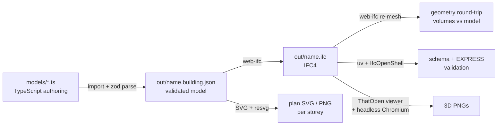
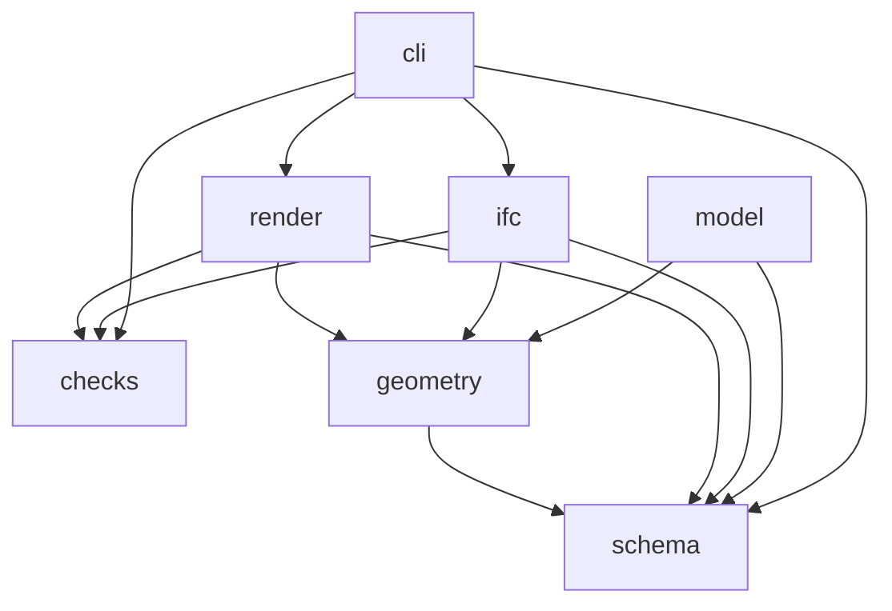

# Architecture

## The pipeline



1. **Authoring.** A model is a TypeScript file in `models/` whose default export is a
   `BuildingModel`. TypeScript is used for authoring only, so models can use named variables,
   arithmetic and helpers ("every window is `windowW` wide"). Changing one variable changes every
   element derived from it.
2. **The JSON contract.** The CLI imports the model, round-trips it through JSON and parses it with
   the zod schema in `src/schema/schema.ts`. The result is written to `out/<name>.building.json`.
   This file sits between authoring and everything downstream, so it can be diffed, and a model
   could be written in another language as long as it produces the same JSON.
   `schema/building.schema.json` is the same schema exported as JSON Schema (draft 2020-12).
3. **IFC.** `build` reads the JSON file back, re-parses it and writes IFC4 with
   [web-ifc](https://github.com/ThatOpen/engine_web-ifc). IFC is only ever produced by this
   writer, never by hand.
4. **Verification.**
   - The IFC is re-opened in web-ifc and every element is meshed. Volumes must match the model,
     which proves the openings really cut the walls.
   - The file is validated by IfcOpenShell (schema, types, inverse attributes and EXPRESS
     where-rules) through a single `uv run` Python script.
5. **Rendering.**
   - Plans are drawn as SVG straight from the model (not from the IFC), and rasterised to PNG with
     resvg using bundled fonts.
   - 3D snapshots render the IFC itself in the browser viewer, so they show what other IFC tools
     will see.

## Design principles

- **Deterministic.** The same model always gives byte-identical JSON, IFC, SVG and PNG output:
  - GlobalIds are derived from element ids.
  - The IFC header timestamp is fixed.
  - Number formatting is fixed.
  - Fonts are bundled rather than taken from the system.

  This is what makes diffs small and meaningful.
- **Stable identity.** Every element has a kebab-case id that is stable across edits. Ids are used
  for GlobalIds, IFC `Tag`s, SVG `data-id`s and every message the tools print.
- **Integer millimetres.** Lengths are branded `Mm` integers, so a fractional or unit-less number is
  a type error in the model file and a schema error at runtime.
- **Small schema.** Only Project/Site/Building/Storey, Wall, Opening (door/window), Slab and Room
  exist. New element types are added deliberately (see [Development](development.md)), not
  invented to fit a model.
- **Errors point at the model.** Every issue is reported against an element id, never only a JSON
  path or an IFC `#123` line.
- **Generated files are never edited.** `out/` and `schema/building.schema.json` are outputs.

## Source layout

```
models/              building models (the only files you normally edit)
schema/              generated JSON Schema (committed; a test fails if it is stale)
src/
  schema/            units (Mm, mm(), m(), deg()) and the zod schema
  model/             authoring helpers: wall, rectWalls, face, rectRoom, door, window, centredOn
  geometry/          2D vector, wall and polygon maths shared by renderers, writer and checks
  checks/            Issue type and formatting (model-level checks will live here)
  cli/               command entry point, model loading, deterministic JSON formatting
  ifc/               IFC writer, GUIDs, round-trip geometry checks, validator bridge
  render/            plan SVG, PNG rasterising, 3D snapshot driver
validator/           validate.py (PEP 723 script for uv) and its lockfile
viewer/              ThatOpen + Vite browser viewer, also used for 3D snapshots
scripts/             one-off generators (JSON Schema export)
tests/               vitest suites, fixtures and the plan SVG snapshot
```

### Dependencies between modules



`schema` depends on nothing in the project. `geometry` depends only on schema types. The CLI is the
only module that touches the filesystem layout of `out/`.

## Key technology choices

| Concern | Choice | Why |
|---|---|---|
| Schema | zod 4 | one definition gives the TypeScript types, runtime validation and the JSON Schema export |
| IFC writing | web-ifc (ThatOpen) | typed IFC4 entity classes and a mesher in the same library, so the writer's output can be checked straight away |
| IFC validation | IfcOpenShell via `uv run` | the reference open-source validator, including EXPRESS rules; uv keeps it to one locked script with no manual Python setup |
| Plan rendering | hand-written SVG + resvg | deterministic, no browser needed, and the SVG can be read and snapshot-tested |
| 3D viewing | @thatopen/components + three.js, Playwright for headless snapshots | renders the real IFC; the same page works interactively and headless |
| Running TS | tsx, with `tsc` used only for type-checking | no build step; models are imported directly |

All dependency versions are pinned exactly in `package.json` and `validator/validate.py`.
